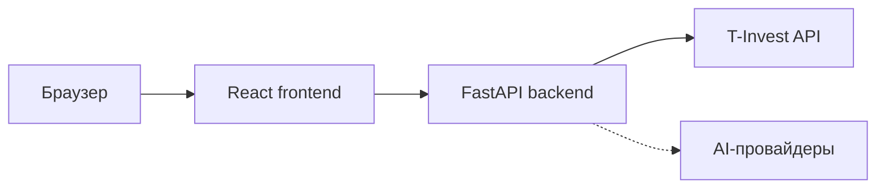
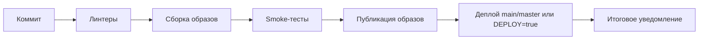

# InvestHelper

Веб-приложение для просмотра и анализа инвестиционного портфеля по данным
T-Invest API. Объединяет брокерские счета, позиции, операции и инструменты
поиска облигаций в одном интерфейсе.

## Возможности

- Просмотр брокерских счетов и состава портфеля.
- Стоимость, доходность и распределение активов.
- История операций.
- Скринер облигаций с фильтрами, ценами, доходностью и сроками погашения.
- Скринер долговых ЦФА.
- AI-чат при настройке ключей Gemini или Groq.
- Диагностика соединения backend с T-Invest API.

## Архитектура



Frontend использует React, TypeScript, Vite и Recharts. Backend на Python/FastAPI
обращается к внешним API и возвращает данные интерфейсу. Токен T-Invest хранится
на стороне backend и не передаётся в браузер.

При контейнерном запуске Nginx отдаёт собранный frontend и проксирует `/api`
в backend. При разработке эту функцию выполняет proxy Vite.

Инфраструктура VM, Jenkins и мониторинга управляется отдельно в репозитории
`InvestHelper.Infrastructure`.

## Быстрый запуск в Docker

Нужны Docker Engine и Docker Compose, а также действующий токен T-Invest API.
Для просмотра портфеля достаточно токена с правами чтения.

Из корня проекта в PowerShell:

```powershell
Copy-Item .env.example .env
notepad .env
```

Укажите `TINKOFF_TOKEN`, затем запустите:

```powershell
docker compose up --build -d
```

Приложение: <http://localhost:8080/>. Порт меняется через `APP_PORT` в `.env`.

```powershell
docker compose ps
docker compose logs -f
docker compose down
```

Секреты передаются контейнеру при запуске и не добавляются в образы.
Для Docker используется `.env` в корне, для локального backend — `backend/.env`.
Это разные файлы конфигурации.

## Локальная разработка

Используйте Python 3.12 и Node.js 22 для соответствия окружению сборки.
Backend и frontend запускаются в отдельных терминалах.

### Backend

Из корня проекта в PowerShell:

```powershell
cd backend
python -m venv .venv
.\.venv\Scripts\python.exe -m pip install -r requirements.txt -r requirements-dev.txt
Copy-Item .env.example .env
notepad .env
```

Заполните `TINKOFF_TOKEN`, затем запустите:

```powershell
.\.venv\Scripts\python.exe -m uvicorn app.main:app --reload --port 8000
```

Backend: <http://127.0.0.1:8000/>.

### Frontend

В другом терминале из корня проекта:

```powershell
cd frontend
npm ci
npm run dev
```

Интерфейс: <http://localhost:5173/>. Запросы `/api` проксируются на backend
`127.0.0.1:8000`.

Для Linux/macOS путь к Python в venv — `.venv/bin/python`,
а файлы шаблонов копируются командой `cp`.

### Запуск на Windows через ярлык

После установки зависимостей и подготовки `backend/.env` можно использовать
`start.bat` в корне проекта. Он запускает оба сервиса и открывает браузер.
Создать ярлык на рабочем столе:

```powershell
powershell.exe -NoProfile -ExecutionPolicy Bypass -File .\create-desktop-shortcut.ps1
```

## Конфигурация

Основные параметры backend:

| Переменная | Назначение |
|---|---|
| `TINKOFF_TOKEN` | Обязательный токен T-Invest API |
| `TINKOFF_MODE` | `prod` или `sandbox`, по умолчанию `prod` |
| `TINKOFF_SSL_VERIFY` | Проверка TLS, по умолчанию включена |
| `TINKOFF_SSL_CA_FILE` | Путь к доверенному набору CA, если нужен дополнительный сертификат |
| `TINKOFF_HTTPS_PROXY` | Необязательный HTTP-прокси для запросов API |
| `GEMINI_API_KEY` | Ключ Gemini для AI-чата |
| `GROQ_API_KEY` | Ключ Groq для AI-чата |
| `GEMINI_MODEL`, `GROQ_MODEL` | Модели соответствующих провайдеров |
| `CHAT_MAX_OUTPUT_TOKENS` | Ограничение размера ответа AI |

Параметры корневого Compose:

| Переменная | Назначение |
|---|---|
| `APP_PORT` | Внешний порт приложения, по умолчанию `8080` |
| `APP_VERSION` | Тег локально собираемых образов, по умолчанию `local` |

Шаблоны: `.env.example` и `backend/.env.example`. Рабочие токены и ключи
не должны попадать в Git. После изменения локального `.env` перезапустите backend;
для Docker повторно выполните `docker compose up -d`.

### TLS и прокси

Ошибка `CERTIFICATE_VERIFY_FAILED` означает, что backend не смог проверить
цепочку сертификатов. Настройте доверенный PEM-набор через `TINKOFF_SSL_CA_FILE`,
сохраняя проверку TLS включённой. API может использовать цепочку Russian Trusted
Root/Sub CA; корпоративный прокси также может требовать свой CA.

В контейнере путь должен вести к файлу **внутри контейнера**. При локальном
Docker-запуске сертификат нужно отдельно смонтировать через Compose override:
корневой `compose.yaml` не монтирует пользовательские CA автоматически.
В управляемой инфраструктуре CA bundle настраивает Ansible.

Адрес прокси также должен быть доступен из backend. `127.0.0.1` внутри контейнера
указывает на сам контейнер, а не на Windows-хост.

## Интерфейс и диагностика

| Путь | Назначение |
|---|---|
| `/` | Портфель |
| `/operations` | Операции |
| `/bonds` | Скринер облигаций |
| `/dfa` | Скринер долговых ЦФА |
| `/api/health` | Проверка готовности backend |
| `/api/diagnostics` | Диагностика подключения к T-Invest API |

При Docker-запуске эти пути доступны на `localhost:8080`, при локальной
разработке — через frontend на `localhost:5173`.
Nginx также отдаёт `/health` для проверки frontend.

Health endpoint подтверждает готовность сервиса, но не действительность токена
и не доступность внешних API. Для этих случаев используйте диагностику.
Ответ HTTP 401 от T-Invest указывает на проблему авторизации, а не на отказ TLS.

## Проверки качества

Линтер backend и CI-скриптов, из корня проекта в PowerShell:

```powershell
.\backend\.venv\Scripts\ruff.exe check backend/app ci
```

Frontend:

```powershell
cd frontend
npm run lint
npm run build
```

Pipeline дополнительно выполняет пять smoke-тестов собранных Docker-образов:

| Проверка | Ожидаемый результат |
|---|---|
| Backend через Nginx | `/api/health` возвращает HTTP 200 и `status: ok` |
| Frontend и статические ресурсы | HTML и собранные JS/CSS доступны |
| Маршрутизация SPA | Прямой переход по вложенному пути возвращает страницу приложения |
| Валидация скринера | `page=0` отклоняется с HTTP 422 |
| Валидация чата | Пустой запрос отклоняется с HTTP 422 |

Тесты запускаются на CI-машине в отдельном Compose-проекте, без настоящих
финансовых токенов и вызовов внешних API. Проверки не покрывают финансовые расчёты,
полноценное взаимодействие с браузером и нагрузку.
Отчёт JUnit доступен в Jenkins Test Result и артефакте `artifacts/smoke.xml`.
Логи тестовых контейнеров сохраняются в `artifacts/container-logs.txt`.

## CI/CD и окружения

`Jenkinsfile` определяет multibranch pipeline:



Jenkins сканирует репозиторий раз в минуту. Все ветки с Jenkinsfile проходят CI
и публикуют образы. Деплой выполняется после успешных проверок и публикации.

Ветки `main`/`master` публикуются автоматически после успешного CI независимо
от флага `DEPLOY`. Для остальных веток деплой включается флагом `DEPLOY`;
по умолчанию они проходят CI и публикуют образы в Registry без обновления стенда.
Во всех случаях стенд выбирается через `DEPLOY_ENV`: prod или staging.

| Параметр | Значение по умолчанию | Назначение |
|---|---|---|
| `APP_VERSION` | `1.0.0` | Префикс уникального тега образов |
| `DEPLOY` | `false` | Включить деплой остальных веток; main/master публикуются автоматически |
| `DEPLOY_ENV` | `prod` | Целевой стенд: `prod` или `staging` |

Тег включает номер билда, Git SHA и хеш ветки. На сервер доставляется тот же
образ, который прошёл тестирование. Деплой проверяет готовность контейнеров
и HTTP endpoints.

В окружении `InvestHelper.Infrastructure` используются:

- Registry: `192.168.56.10:5000`;
- prod: <http://192.168.56.20:8080/>;
- staging: <http://192.168.56.20:8082/>.

Для публикации любой ветки откройте её job → **Build with Parameters**,
включите **DEPLOY**, выберите **DEPLOY_ENV** и запустите сборку.
Текущая версия выбранного стенда будет заменена, другой стенд не обновляется.
Если параметр ещё не появился в UI, отправьте актуальный Jenkinsfile и дождитесь
одного запуска job. Отдельные окружения для каждой ветки не создаются.

Prod и staging находятся на одной VM и используют общий runtime `.env`.
Секреты на сервере управляются Ansible и не берутся из локальных `.env` Windows.
Подготовка инфраструктуры описана в README репозитория `InvestHelper.Infrastructure`.

### Telegram

Pipeline ожидает два Jenkins credentials типа **Secret text**:

- `telegram-bot-token` — токен бота;
- `telegram-chat-id` — ID чата, доступного боту.

Они могут быть созданы вручную либо автоматически через bootstrap инфраструктуры.
Сообщение содержит статус pipeline и результат деплоя: `SUCCESS`, `FAILURE`,
`ABORTED` или `SKIPPED`. Для пропуска указывается причина.
Ошибка доставки отражается в console log и не меняет результат сборки.

## Структура репозитория

```text
backend/                  FastAPI, клиенты внешних API, обработка данных
frontend/                 React-интерфейс, Vite, конфигурация Nginx
ci/                       smoke-тесты и Telegram-уведомления
compose.yaml              локальная сборка и запуск контейнеров
Jenkinsfile               CI/CD приложения
.env.example              параметры Docker Compose
backend/.env.example      параметры локального backend
start.bat                 запуск сервисов на Windows
create-desktop-shortcut.ps1 создание ярлыка Windows
```

## Ограничения текущей версии

- Доступность и полнота данных зависят от внешних API и прав токена.
- AI-чат требует настроенного ключа провайдера.
- Smoke-тесты проверяют запуск и базовые HTTP-сценарии, а не всю бизнес-логику.
- Staging не изолирует внешние API от prod при использовании общей конфигурации
  инфраструктуры; выбор sandbox настраивается отдельно.
- Встроенная проверка здоровья не подтверждает доступность T-Invest API.
